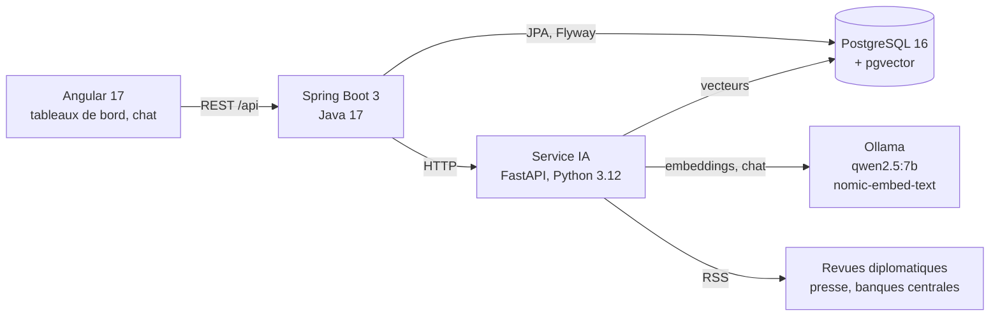

# Local Finance Analyzer

**Analyseur financier propulsé par une IA 100 % locale, alimenté en contexte par une revue de presse diplomatique mondiale.**

*A finance analyzer running a local LLM (Ollama) with retrieval-augmented generation over company reports, personal bank statements and a one-year rolling world press review where diplomatic journals come first. Nothing leaves your machine.*


---

## Pourquoi ce projet

Les chiffres d'une entreprise ou d'un budget ne disent pas tout : une sanction, un conflit ou une décision de banque centrale changent leur lecture.
L'application croise donc trois sources de contexte avant de répondre :

| Module | Ce qu'il fait |
|---|---|
| **Revue de presse mondiale** | Collecte 18 flux publics, **revues diplomatiques et think tanks en priorité** (Foreign Affairs, Foreign Policy, The Diplomat, IRIS, Le Grand Continent, Diploweb, Atlantic Council, War on the Rocks, International Crisis Group, Le Monde diplomatique), puis presse économique et banques centrales (BCE, Fed). Historique glissant d'**un an**, synthèse rédigée par l'IA locale. |
| **Rapports d'entreprises** | Import de rapports annuels PDF, découpage, vectorisation, questions en langage naturel avec **citation des pages** et, au choix, de la presse. |
| **Budget personnel** | Import d'un relevé CSV bancaire, catégorisation **hybride** (règles puis modèle local), tableau de bord sur 12 mois, analyse tenant compte de l'actualité (inflation, taux, énergie). |

Toutes les inférences tournent sur la machine avec [Ollama](https://ollama.com) : aucun relevé bancaire ni document n'est envoyé à un service externe.

## Architecture



| Composant | Rôle | Technologies |
|---|---|---|
| `backend/` | API métier : documents, opérations, budget, presse, planification de la collecte | Spring Boot 3.3, JPA, Flyway, Bean Validation, RestClient, springdoc OpenAPI, JUnit 5 |
| `ai-service/` | Extraction PDF, découpage, embeddings, recherche vectorielle, prompts, collecte RSS | FastAPI, psycopg 3, pgvector, pypdf, feedparser, pytest |
| `frontend/` | Interface | Angular 17 (standalone, signals), Chart.js |
| `docker-compose.yml` | Orchestration, GPU NVIDIA pour Ollama | Docker Compose |

### Choix techniques

- **RAG avec citations** : chaque réponse renvoie les passages utilisés (`[R1]` page d'un rapport, `[N1]` article) ; le prompt interdit d'inventer ce qui n'est pas dans le contexte.
- **Priorité diplomatique** : les sources ont une priorité (1 = revues diplomatiques). À pertinence proche, un bonus de score les fait passer devant ; la synthèse les traite en premier.
- **Fenêtre d'un an** : au premier lancement, les archives paginées des flux sont parcourues jusqu'à un an ; ensuite la collecte tourne toutes les deux heures et purge ce qui dépasse 365 jours (`HISTORY_DAYS`).
- **Respect des sources** : seuls le titre, le résumé publié dans le flux et le lien sont conservés.
- **Catégorisation hybride** : des règles déterministes classent la majorité des opérations ; le modèle ne traite que les libellés inconnus, sa sortie JSON est validée (catégories autorisées, repli sur « Autres »).
- **Confidentialité** : le modèle ne voit que des agrégats du budget, jamais le relevé brut.
- **Import robuste** : séparateur `;` ou `,`, dates `jj/mm/aaaa` ou ISO, montant unique ou colonnes débit/crédit, encodage Windows-1252, dédoublonnage par empreinte SHA-256.

## Démarrage

Prérequis : Docker Desktop, et pour la carte graphique un GPU NVIDIA avec le support GPU de Docker (6 Go de VRAM suffisent pour `qwen2.5:7b`).

```bash
cp .env.example .env
docker compose up -d --build
```

Le premier démarrage télécharge les modèles (environ 5 Go) puis charge l'historique de presse en arrière-plan.

| Service | URL |
|---|---|
| Application | http://localhost:4200 |
| API (Swagger) | http://localhost:8080/swagger-ui.html |
| Service IA (docs) | http://localhost:8000/docs |

Pour essayer le budget, importez `samples/releve_demo.csv` (relevé fictif de 12 mois) depuis l'écran **Opérations**.
Pour les rapports, importez par exemple le document d'enregistrement universel d'une société cotée (PDF public).

Sans GPU, supprimez le bloc `deploy` du service `ollama` dans `docker-compose.yml` : tout fonctionne, plus lentement.

### Développement

```bash
# Backend
cd backend && mvn verify

# Service IA
cd ai-service && pip install -r requirements-dev.txt && pytest

# Frontend (proxy vers localhost:8080)
cd frontend && npm install && npm start
```

## API principale

| Méthode | Route | Description |
|---|---|---|
| `GET` | `/api/news?category=diplomatie&days=30` | Articles, priorité diplomatique d'abord |
| `POST` | `/api/news/refresh` | Lance une collecte |
| `POST` | `/api/news/digest?hours=24` | Génère la revue de presse |
| `POST` | `/api/documents` | Importe un rapport PDF (indexation asynchrone) |
| `POST` | `/api/reports/ask` | Question sur les rapports, avec ou sans presse |
| `POST` | `/api/transactions/import` | Importe un relevé CSV |
| `GET` | `/api/budget/summary` | Agrégats sur 12 mois glissants |
| `POST` | `/api/budget/ask` | Analyse du budget en contexte |

## Tests et qualité

- Backend : parsing CSV (formats bancaires, montants, dédoublonnage), règles de catégorisation, agrégats du budget.
- Service IA : découpage du texte, validation de la sortie du modèle, parsing RSS, priorité des sources diplomatiques.
- CI GitHub Actions : build et tests des trois modules, puis construction des images Docker.

## Pistes d'évolution

- Authentification (Spring Security, JWT) et multi-utilisateurs.
- OCR des PDF scannés, extraction des tableaux financiers.
- Suivi d'une liste d'entreprises avec alertes quand la presse diplomatique évoque leurs pays d'activité.
- Évaluation automatique de la qualité des réponses (jeu de questions de référence).

## Avertissement

Projet personnel à visée pédagogique. Les analyses sont informatives et ne constituent pas un conseil en investissement.

## Auteur

**Sami Guetarni** · Ingénieur logiciel et data · [LinkedIn](https://www.linkedin.com/in/sami-guetarni-7b671820b) · [GitHub](https://github.com/Ednar17)
